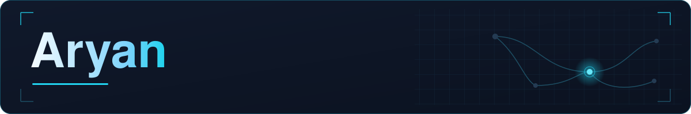

**Software Engineer** · Backend-focused full stack developer

Mohali, Punjab, India · 1.5+ years

Build systems that make developers' lives easier.

[Portfolio](https://portfolio-arya7n.vercel.app) · [LinkedIn](https://www.linkedin.com/in/aryan-46191b265) · [Email](mailto:aryan11jr@gmail.com) · [Resume](https://portfolio-arya7n.vercel.app/resume.pdf)

 

Backend systems, realtime paths, data, and the developer tools around them. Then the interface.

## Projects

<table>
  <tr>
    <td width="50%" valign="top">
      
      <h3><code>01</code> &nbsp;<a href="https://github.com/Arya7n/devtunnel">DevTunnel</a></h3>
      
A localhost tunnel you run yourself. The CLI exposes a local port over WebSockets. NestJS, the dashboard, JWT and API-key auth, PostgreSQL, Redis, and live request inspection sit behind it. Runs locally.

      
<kbd>NestJS</kbd> <kbd>WebSockets</kbd> <kbd>PostgreSQL</kbd> <kbd>Redis</kbd>

      
<a href="https://github.com/Arya7n/devtunnel">Source</a>

    </td>
    <td width="50%" valign="top">
      
      <h3><code>02</code> &nbsp;<a href="https://github.com/Arya7n/Who-Port">whoport</a></h3>
      
Names the process, project, uptime, and Docker container on a TCP port, then stops it only after checks that leave system processes alone. The CLI and server have no runtime dependencies.

      
<kbd>TypeScript</kbd> <kbd>Node.js</kbd> <kbd>CLI</kbd> <kbd>Docker</kbd>

      
<a href="https://github.com/Arya7n/Who-Port">Source</a>

    </td>
  </tr>
  <tr>
    <td width="50%" valign="top">
      
      <h3><code>03</code> &nbsp;<a href="https://github.com/Arya7n/patent-dev">Patent research workspace</a></h3>
      
<strong>In progress.</strong> Upload a patent and prior-art PDFs, split claims into clauses, search the passages, and export a two-column chart to Word or PDF. Model keys and storage credentials stay on the server.

      
<kbd>NestJS</kbd> <kbd>BullMQ</kbd> <kbd>pgvector</kbd> <kbd>Drizzle</kbd>

      
<a href="https://github.com/Arya7n/patent-dev">Source</a>

    </td>
    <td width="50%" valign="top">
      
      <h3><code>04</code> &nbsp;<a href="https://github.com/Arya7n/cursor-tracker">Cursor Tracker</a></h3>
      
A team view of Cursor plan usage. A desktop or CLI agent reports the plan, billing cycle, and percent used. Access tokens stay on the developer machine.

      
<kbd>Next.js</kbd> <kbd>Electron</kbd> <kbd>PostgreSQL</kbd>

      
<a href="https://cursor-tracker-nu.vercel.app">Live demo</a> · <a href="https://github.com/Arya7n/cursor-tracker">Source</a>

    </td>
  </tr>
  <tr>
    <td width="50%" valign="top">
      
      <h3><code>05</code> &nbsp;<a href="https://github.com/Arya7n/Request-replay">RequestReplay</a></h3>
      
A DevTools panel for the page already open. It redacts likely secrets, copies a curl command, and compares two responses by status, headers, and body.

      
<kbd>TypeScript</kbd> <kbd>React</kbd> <kbd>WXT</kbd> <kbd>Zod</kbd>

      
<a href="https://github.com/Arya7n/Request-replay">Source</a>

    </td>
    <td width="50%" valign="top">
      
      <h3><code>06</code> &nbsp;<a href="https://github.com/Arya7n/APEX">APEX</a></h3>
      
A motorcycle spec archive and showroom. Specifications live in MongoDB, Redis caches them, and Express serves the Next.js app.

      
<kbd>Next.js</kbd> <kbd>Express</kbd> <kbd>MongoDB</kbd> <kbd>Redis</kbd>

      
<a href="https://apex-bikes.vercel.app/">Live demo</a> · <a href="https://github.com/Arya7n/APEX">Source</a>

    </td>
  </tr>
</table>

## More

[Portfolio OS](https://github.com/Arya7n/portfolio-Os) · [Live](https://aryan-portfolio-os.vercel.app/)
&nbsp;&nbsp;·&nbsp;&nbsp;
[ORBITAL-07](https://github.com/Arya7n/space-station) · [Live](https://orbital07.vercel.app/)
&nbsp;&nbsp;·&nbsp;&nbsp;
[JobMate](https://github.com/Arya7n/JobMate)
&nbsp;&nbsp;·&nbsp;&nbsp;
[Cartify](https://github.com/Arya7n/cartify) · [Live](https://cartifymern.vercel.app/)
&nbsp;&nbsp;·&nbsp;&nbsp;
[HRMS](https://github.com/Arya7n/HRMS) · [Live](https://hrms-three-black.vercel.app)

## Experience

**PSQUARE COMPANY** — Full Stack Developer  
December 2025 – Present · Mohali

- Backend services in Node.js and TypeScript, using a microservices architecture.
- Docker, Redis, and BullMQ for containers, caching, and background jobs.
- AWS S3 and SES, plus notification and realtime chat services.
- MongoDB aggregations and REST APIs brought query time down by about 40% and response time by 30–40%.

**NetscapeLabs Infotech Pvt. Ltd.** — Full Stack Developer Trainee  
June 2025 – November 2025

- Shipped two production applications with Next.js, React, and Node.js.
- Realtime notifications with Socket.IO, plus REST APIs and Firebase.
- Shared UI in Tailwind CSS and shadcn/ui, with about a 30% improvement in page load.

## Stack

**Languages** — TypeScript, JavaScript

**Backend** — Node.js, NestJS, Express, REST APIs, Socket.IO, WebSockets

**Frontend** — React, Next.js, Tailwind CSS, Three.js

**Data** — PostgreSQL, MongoDB, Redis, Prisma, Drizzle, Mongoose, pgvector

**Infrastructure** — Docker, BullMQ, AWS S3, AWS SES, Neon, Vercel, PM2

**Tools** — Git, Electron, Chrome extensions, Postman, Vitest, Firebase

## Education

**B.Tech, Information Technology** — CGC Landran, Mohali  
June 2021 – June 2025 · CGPA 7.5/10

## GitHub

<picture>
  <source media="(prefers-color-scheme: dark)" srcset="https://github-readme-stats.vercel.app/api?username=Arya7n&amp;show_icons=true&amp;hide_border=true&amp;theme=transparent&amp;bg_color=00000000&amp;title_color=7DD3FC&amp;icon_color=22D3EE&amp;text_color=C5CDD6&amp;ring_color=164E63" />
  
</picture>

 

<picture>
  <source media="(prefers-color-scheme: dark)" srcset="https://github-readme-stats.vercel.app/api/top-langs/?username=Arya7n&amp;layout=compact&amp;hide_border=true&amp;langs_count=6&amp;theme=transparent&amp;bg_color=00000000&amp;title_color=7DD3FC&amp;text_color=C5CDD6" />
  
</picture>

---

Open to backend and full-stack work. The interesting part is in the repositories above.

[Portfolio](https://portfolio-arya7n.vercel.app) · [LinkedIn](https://www.linkedin.com/in/aryan-46191b265) · [Email](mailto:aryan11jr@gmail.com) · [Resume](https://portfolio-arya7n.vercel.app/resume.pdf)

